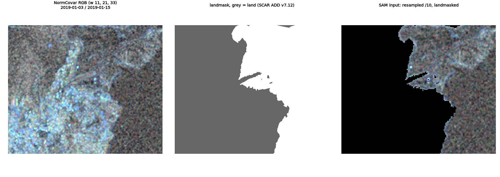
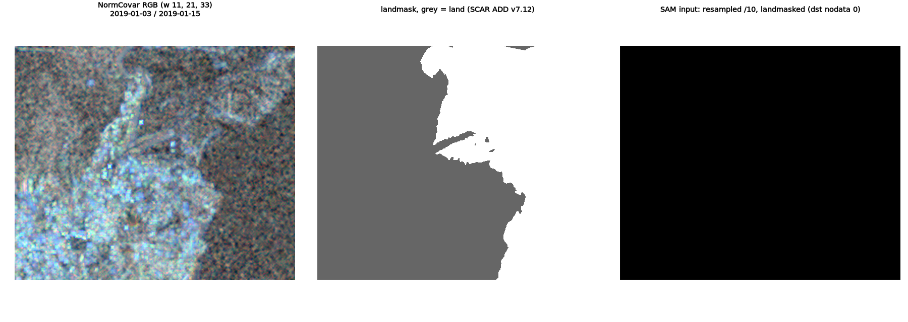

# Case study: fast-ice NormCovar {#sec-fast-ice}

GA's fast-ice project ([abradley60/fast-ice](https://github.com/abradley60/fast-ice), commit
4694c6c) maps landfast sea ice from Sentinel-1. It's a well-built project: a pixi workspace, a
lockfile, and notebooks using odc-stac, xarray and Johannes Lohse's
[normalized_covariance](https://github.com/jlo031/normalized_covariance) (d6843d2).

The NormCovar part of `fast_ice_from_stac_xarray.ipynb` (sections 5-10) converts the loaded
backscatter to dB, forms 12-day pairs, computes NormCovar at three window sizes, stacks them as
an RGB, resamples to 1/10, rasterizes the SCAR coastline into a landmask, and hands the masked
image to SAM (Segment Anything) for segmentation.

## Three installs, three outcomes

The notebook ran on three builds of its own stack, each in a clean container:

| The notebook's stack | What happens |
|---|---|
| fast-ice's **lock**: odc-stac 0.5.2, odc-geo 0.5.1, xarray 2026.4.0, rasterio 1.5.0, GDAL 3.12.3 | Runs. The ports equal it in every product |
| The lock with today's **rasterio 1.5.2 and GDAL 3.13.3** | Runs without error. The resampled landmask is all 1, so **the SAM input is entirely black** |
| **Resolved today** within fast-ice's declared ranges: odc-stac 0.5.3, odc-geo 0.5.4, xarray 2026.9.0 | Fails in section 8: `ValueError: cannot convert float NaN to integer` |

::: {layout-ncol=1}



:::

## How each one happens

**The crash.** odc-stac 0.5.3 began labelling its float32 output `nodata: nan` (0.5.2 set no
attributes). xarray keeps attributes through `10 * log10(...)`. NormCovar copies them onto its
uint8 RGB. odc-geo then can't make a uint8 fill value out of NaN. Four packages, each doing
something reasonable.

**The black image.** Resampling a uint8 array with `dst_nodata=None`, odc-geo still passes its
fill value 0 to rasterio as the destination nodata. rasterio 1.5.0 didn't hand it on to the
warp; 1.5.1 and later do. Since 3.11, GDAL's warper rewrites any valid pixel equal to the
destination nodata to the next value, so that it isn't read as nodata, and warns once:

```
Value 0 in the source dataset has been changed to 1 in the destination dataset to avoid
being treated as NoData.
```

Every 0 in the 0/1 landmask becomes 1, and masking with it blanks the image. Nothing fails. The
RGB resample changes too, in 5 pixels.

The lockfile protected fast-ice. Anyone who installs from its `pyproject.toml` ranges, or
upgrades one package, meets one of the other two rows.

## The port

The port uses stacgrid for the load (only the two images of a pair), numpy and scipy for the
NormCovar arithmetic, and `gdal.Warp` and `gdal.Rasterize` for the two geo steps. In R it's
stacgrid, base R (a cumulative-sum box filter), gdalraster's `warp()` and `rasterize()`, and
ximage for the figure. Neither touches the paths above.

| | Python port vs locked notebook | R port vs Python port |
|---|---|---|
| Loads, both images (dB) | equal | R holds doubles: float32 rounding, max 6.8e-6 |
| NormCovar at windows 11, 21, 33 | equal | float32 vs double rounding |
| RGB (uint8) | equal | 51 of 7.1 M values differ by 1 |
| RGB, landmasked | equal | 30 values differ by 1 |
| Resampled RGB | equal | 1 value differs |
| Landmask, resampled landmask | equal | equal |
| SAM input (resampled, landmasked) | equal | 1 value differs |

Same 57 pairs, same grids, every case.

The ports warp with no destination nodata, which is what the locked notebook effectively does.
Setting `NC_ODC_NODATA=1` makes them pass `dstNodata=0` as odc-geo does, and then they
reproduce the rasterio 1.5.1+ result exactly, black SAM input included, in Python and R.

The R port met one more GDAL behaviour: `gdal_rasterize` sets NoData = 0 on any output it
creates ([chapter @sec-versions]), so a 0/1 mask's water read back as NA. It burns into an
existing zero raster instead, as the Python port does into a MEM dataset.

Evidence: [`evidence/normcovar/`](https://github.com/mdsumner/geo-stack-alt/tree/main/evidence/normcovar);
scripts in [`cleanroom/experiments/normcovar/`](https://github.com/mdsumner/geo-stack-alt/tree/main/cleanroom/experiments/normcovar)
(`nc_ref.py` is the notebook as a script, `nc_gdal.py` and `nc_r.R` the ports).

## Not run

SAM and the SVM classifier (they need torch). The port stops at the SAM input.
