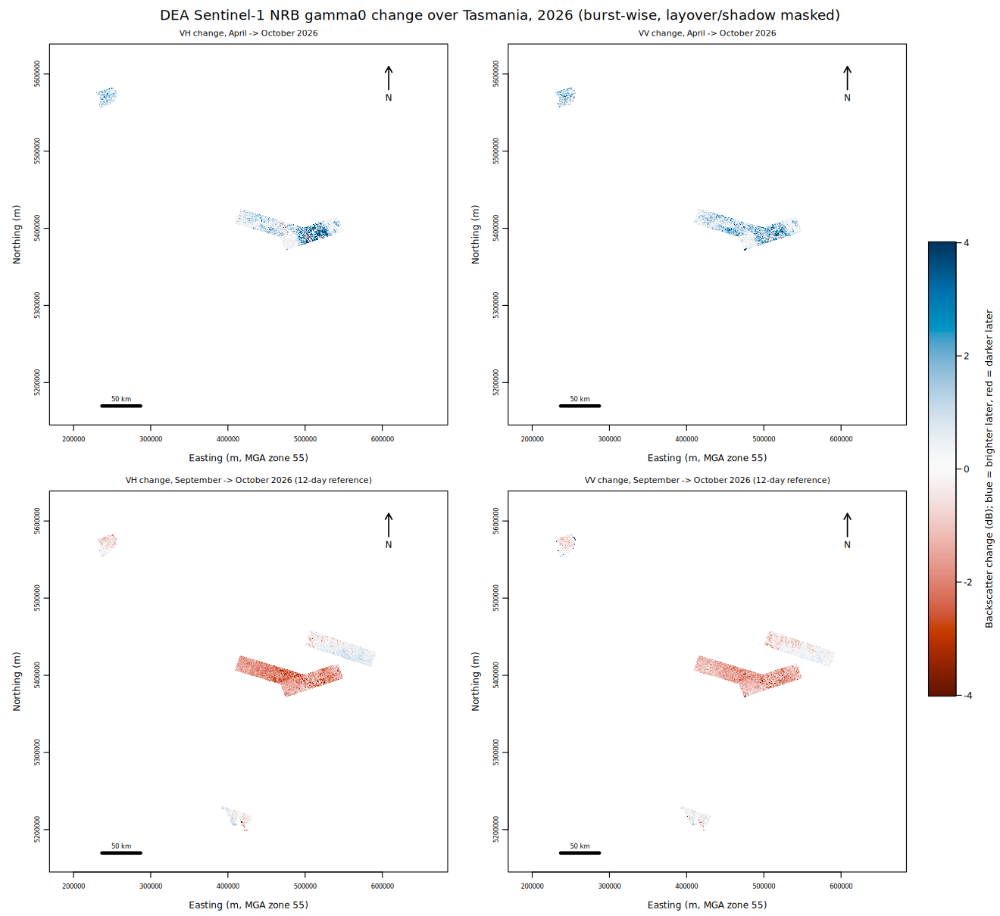
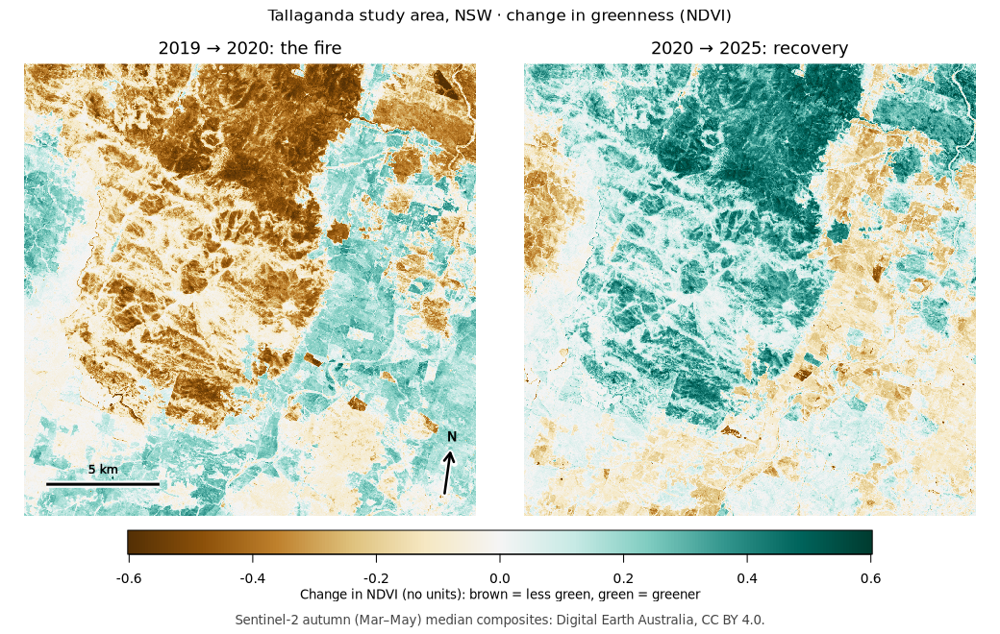

# Porting four real projects {#sec-projects}

A probe isn't a workload. So four recent projects, all resting on the usual rasterio-level
operations (read, reproject onto a grid, rasterize, write COGs, plot), were ported to
`osgeo.gdal`, and some of their figures redone in R. The original and the port then ran in the
same clean container against **one** libgdal (apt's `python3-rasterio` and `python3-gdal` link
the same file), so any difference comes from the code, not from two GDAL builds.

| Project | What it does | Result | Evidence |
|---|---|---|---|
| tasmania-s1-change | Sentinel-1 NRB bursts from S3, boxcar, dB change, per-burst windowed `reproject` (average) into a state mosaic, land mask (rasterize), COG | **Bit-identical**: 7 bursts and 3 mosaics, max diff 0, same masks, same stats. No rasterio or shapely in the port | `tas-s1-compare/` |
| … its figures, in R | 2×2 change maps and histogram with ximage, gdalraster, base graphics | Same decimated pixels as Python's averaged read; stats equal to float32 rounding | `tas-s1-figure/` |
| mi-island-s1-mirounga | Reuses the tasmania per-scene step | Covered by the above | |
| aeo26-workshop | Sentinel-2 composites, fire severity, glider records | The presenters' scripts ported: answer table identical, all 3 example PNGs **byte-identical** | `aeo26-compare/` |
| … its figures, in R | False colour, NDVI change, severity with gliders, with ximage and gdalraster | Same printed numbers; decimated severity pixels 0 of 1,000,000 differ | `aeo26-figure/` |
| ga-sar-ice (GA tutorial) | `odc.stac.load` of 45 IW bursts, solar-day groups, 200 m EPSG:3031 | Plain `osgeo.gdal`: **every pixel equal**, but ~90 lines against ~15. With `stacgrid`: ~10 lines in Python or R, every pixel equal | `ga-sar-ice-compare/`, `stacgrid/` |
| … GA's fast-ice notebooks | EW from STAC-GeoParquet, IW from the API, grouped by time, solar day and relative orbit, 40 m EPSG:3031, up to 150 items | With `stacgrid`, Python and R: same items, grids and groups, **0 of 217 M pixels differ** | `fast-ice/` |
| … and its NormCovar | dB, 12-day pairs, NormCovar at three windows, RGB, 1/10 resample, coastline landmask, the SAM input | **Every product equal** to the notebook at its locked versions ([chapter @sec-fast-ice]) | `normcovar/` |

Evidence paths are under
[`evidence/`](https://github.com/mdsumner/geo-stack-alt/tree/main/evidence). The originals sit
unchanged beside their ports in
[`cleanroom/experiments/`](https://github.com/mdsumner/geo-stack-alt/tree/main/cleanroom/experiments).

## What the ports cost

Line counts: tasmania 415 → 459, check_values 181 → 199, make_examples 267 → 277. The extra
lines are the two helpers rasterio hides:

- **A coordinate transform with explicit axis order.** `osr` follows the CRS's axis order
  (lat/lon for EPSG:4326) unless told otherwise; rasterio sets traditional GIS order for you.
- **An OGR rasterize.** rasterio's `features.rasterize` takes shapely geometries; the port builds
  an OGR layer (or opens the vector file) and calls `gdal.Rasterize`.

The GA tutorial load is the exception: odc-stac does a lot in 15 lines, and plain `osgeo.gdal`
took 90. That gap is what `stacgrid` closes ([chapter @sec-stac]).

## From rasterio to osgeo.gdal

| rasterio | osgeo.gdal |
|---|---|
| (exceptions by default) | `gdal.UseExceptions()` |
| `rasterio.open(p).read(1)` | `ds = gdal.Open(p); ds.GetRasterBand(1).ReadAsArray()`, keeping `ds` in a variable |
| `reproject(src, dst, ...)` into a window | `gdal.Warp("", src, format="MEM", outputBounds=, width=, height=, dstSRS=, resampleAlg=)` |
| `transform_bounds` | `osr.CoordinateTransformation(a, b).TransformBounds(...)` |
| CRS with lon/lat order | `srs.SetAxisMappingStrategy(osr.OAMS_TRADITIONAL_GIS_ORDER)` on every `SpatialReference` |
| `features.rasterize(shapes, ...)` | `gdal.Rasterize(dst_ds, gdal.OpenEx(vector, gdal.OF_VECTOR), burnValues=[1])` |
| write a COG | `gdal.Translate(out, src, format="COG")` |

In R, gdalraster's `warp()`, `rasterize()`, `translate()` and `GDALRaster` cover the same steps,
and `ximage` draws arrays and rasters with their georeferencing.

## The same ports on pixi

Everything above was repeated in one pixi env on a bare `ubuntu:24.04`: conda-forge GDAL 3.13.3
shared by osgeo.gdal, rasterio 1.5.2, odc-stac 0.5.3 and R (gdalraster 2.7.0), with Python 3.15,
numpy 2.5 and matplotlib 3.11.

| | Within the pixi env (original vs port, or Python vs R) | pixi (GDAL 3.13.3) vs apt (3.8.4) |
|---|---|---|
| tasmania bursts, mosaics | 0 pixels differ | bursts: 0 differ. Mosaics: 1 pixel of 593,064 in one band, by 5.8e-11 |
| tasmania stats, Python vs R | equal to float32 rounding | |
| aeo26 answer table, printed numbers | identical | identical, Python and R |
| aeo26 PNGs | original vs port byte-identical; R severity pixels 0 of 1,000,000 differ | same content; rendering differs (matplotlib versions; R fonts) |
| ga-sar-ice: odc, plain GDAL, stacgrid Python and R | 0 pixels differ | 0 differ, each loader |
| ga-sar-ice: STACIT vs no-overview last-wins warp | 0 differ | 0 differ against apt 26.04 (GDAL 3.12.2); it can't run on 3.8.4 |

Install from a bare image: apt curl 16-27 s, pixi 2-4 s, the alt stack 5-6 s, ximage 3 s; 2.2 GB
env. The one mosaic pixel is probably numpy (1.26 against 2.5) in the mosaic arithmetic, since
every input burst is identical.

